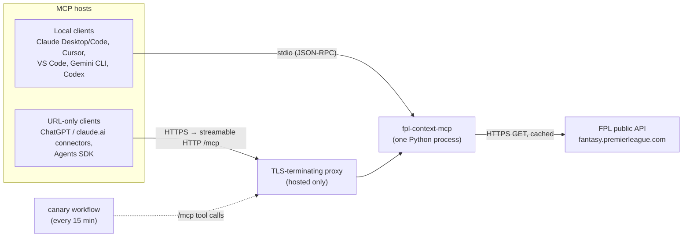
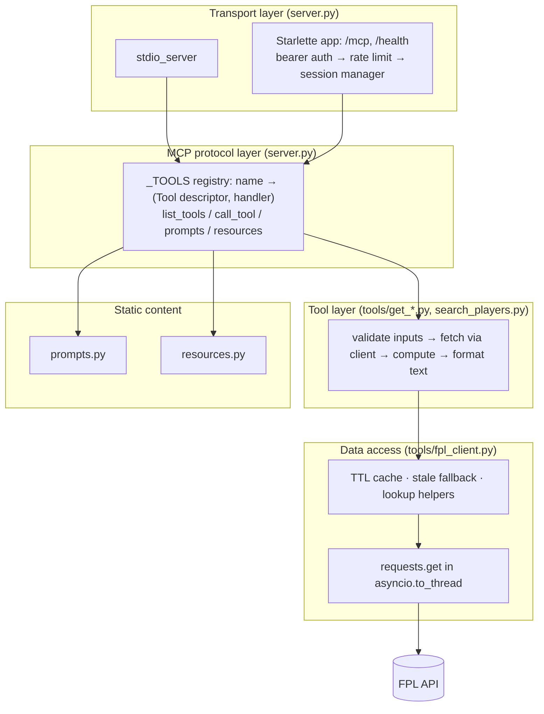
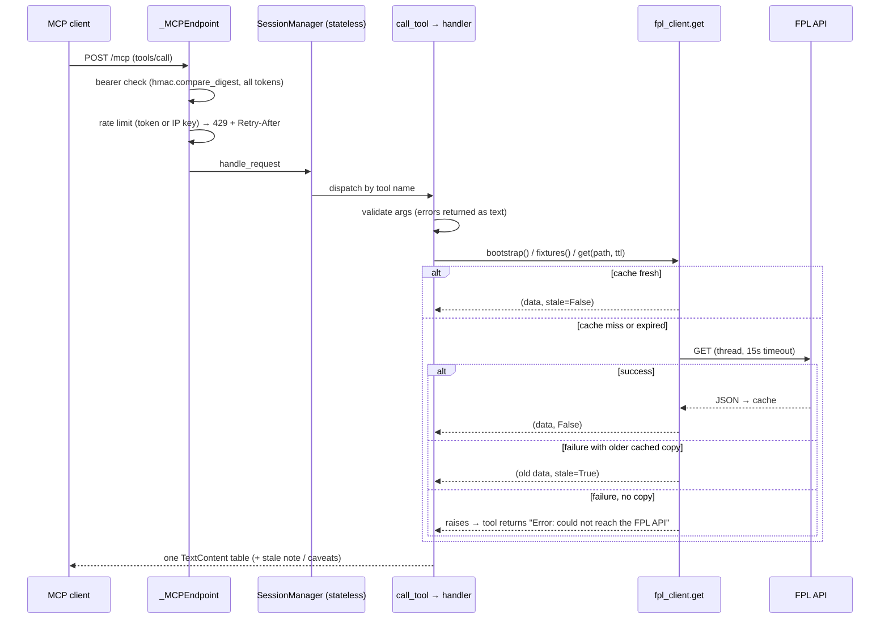

# Architecture

How `fpl-context-mcp` is built, why it is built that way, and what each choice costs.
For setup see the [README](../README.md); for running a public endpoint see
[hosting.md](hosting.md); for contributor conventions see [CLAUDE.md](../CLAUDE.md).

## 1. What it is

A stateless [Model Context Protocol](https://modelcontextprotocol.io) server that gives an AI
assistant live Fantasy Premier League data. It is a thin, read-only adapter over the public,
unauthenticated FPL API (`https://fantasy.premierleague.com/api/`):

- **9 tools** (gameweek, fixtures, fixture run, player search, player history, gameweek stats,
  xPts, manager squad, live availability), all annotated read-only.
- **3 prompts** (`captain_pick`, `transfer_plan`, `chip_timing`) and **1 resource**
  (`fpl://glossary`).
- **2 transports**: stdio (default, launched by a local client) and streamable HTTP at `/mcp`
  (for URL-only clients such as ChatGPT connectors).
- **No database, no required configuration.** `uvx fpl-context-mcp` works out of the box.

### Goals
1. Zero-setup install and run.
2. Always-live data, with graceful degradation when FPL is down.
3. Safe to host publicly (auth, rate limiting, non-root container, health check).
4. Output a language model reads well and cannot misuse (plain text, validated inputs, caveats
   included in the output).

### Non-goals
- Historical analytics or a data warehouse (see [Decision 1](#decision-1-no-database)).
- Write actions against FPL (transfers, team changes): no login is supported or wanted.
- Serving data from sources whose terms do not allow use through an AI tool (the licensing
  guardrail in CLAUDE.md).

## 2. System context

The server is a single process with no persistent state. Every external dependency other than
the FPL API (PyPI, MCP Registry, GitHub Actions) is build/release-time only.

## 3. Layers

| Layer | Files | Responsibility |
|---|---|---|
| Entry / transport | `server.py` (`main`, `_serve`, `build_http_app`, `_serve_http`) | CLI flags, stdio loop, HTTP app, auth, rate limiting |
| Protocol | `server.py` (`_TOOLS`, `list_tools`, `call_tool`, prompt/resource handlers) | Tool descriptors and JSON Schemas, dispatch, annotations |
| Tools | `tools/get_*.py`, `tools/search_players.py` | One module per tool; input validation, domain logic, text formatting |
| Content | `tools/prompts.py`, `tools/resources.py` | Instruction-only prompts and the glossary resource |
| Data access | `tools/fpl_client.py` | The only HTTP client; cache; name resolution; shared formatting |
| Support | `tools/ratelimit.py`, `config.py` | Fixed-window limiter; lazy env-var config |
| Ops | `Dockerfile`, `scripts/canary.py`, `.github/workflows/*`, `server.json` | Packaging, monitoring, release |

**Dependency rule:** tools depend on `fpl_client`, never on each other's internals, with one
exception: `get_xpts` reuses `search_players.player_row` for row formatting. `server.py` depends
on everything; nothing depends on `server.py`.

## 4. Request lifecycle

A tool call, end to end (HTTP transport; stdio skips the auth/limit steps):

Typical bootstrap-backed tools make zero FPL calls on a warm cache. `get_manager_squad` makes up
to four cached calls (bootstrap, `entry/{id}/`, `picks`, `history`).

## 5. Key components

### 5.1 Tool registry (`server.py`)
Each tool is registered once with `_register(types.Tool(...), handler)` into the ordered dict
`_TOOLS`. `list_tools` returns the descriptors; `call_tool` looks up the handler and wraps its
string result in a single `TextContent`. Every descriptor carries `readOnlyHint=True`,
`destructiveHint=False`, `idempotentHint=True`, so clients can skip approval prompts. Enumerated
parameters (positions, `sort_by`) come from the same constants the handlers validate against, so
schema and validation cannot drift.

### 5.2 FPL client and cache (`tools/fpl_client.py`)
- One sync `requests.get` run through `asyncio.to_thread`; fixed `User-Agent`, 15 s timeout.
- **Cache:** module-level dict `path → (monotonic fetch time, data)`.
- **TTLs:** bootstrap 300 s, fixtures 300 s, manager entry/picks/history 120 s, per-player
  history 300 s, finished-gameweek live stats 3600 s, in-progress gameweek 120 s.
- **Stale fallback:** if a refresh fails and any older copy exists, return it with
  `is_stale=True`; tools append `STALE_NOTE` so the model can tell the user. A 404 raises
  `FPLNotFound` and is never masked by the cache (an unknown manager ID must not appear valid).
- **Bound:** 256 entries; on overflow the entry with the oldest fetch time is dropped.
- **Shared helpers:** `resolve_team` / `find_player` (exact match, then unique substring, else an
  error listing candidates), `current_gameweek` (in-progress, else next, skipping a finished
  "current"), `to_int`, `format_table`.

### 5.3 Tools
Every tool follows one shape: coerce and validate arguments → fetch via the client → filter,
rank or compute → render a plain-text table plus any caveats. Failures are returned as
`"Error: …"` strings, not raised, so the model sees an actionable message instead of a protocol
error. Notable computation:

- **`get_xpts`** is a deliberately transparent baseline: per-90 xG/xA/clean-sheet/saves/bonus
  rates × scoring weights per position × expected minutes (share of available minutes, capped at
  90) × availability (`chance_of_playing_next_round`, zeroed for `s`/`u`/`n`) × a ±10 % per FDR
  point adjustment around FDR 3, summed over the gameweek's fixtures (so doubles work and
  blanks give 0). Shown next to FPL's own `ep_next`.
- **`get_fixture_run`** derives average FDR, home/away split and blank/double gameweeks from
  `fixtures/`; with no team it ranks all 20.
- **`get_gameweek_stats`** reads `event/{gw}/live/` and labels in-progress gameweeks.

### 5.4 Prompts and resources
`prompts.py` returns instruction text only (which tools to call, in what order, how to present
the answer). Arguments are optional and validated (numeric IDs, chip whitelist). `resources.py`
serves `fpl://glossary`. Neither holds data, so neither can go stale; both must be updated when a
tool is renamed or changed.

### 5.5 HTTP transport (`build_http_app`)
A Starlette app with `/mcp` (GET/POST/DELETE) and `/health`. `/mcp` is a `Route` whose endpoint
is an ASGI class instance (a `Mount` would 307-redirect `/mcp` → `/mcp/`, which some clients do
not follow). The pipeline is: optional bearer auth → per-caller rate limit →
`StreamableHTTPSessionManager(stateless=True)`. `/health` is unauthenticated and unlimited so
platform probes and the container `HEALTHCHECK` never consume quota.

### 5.6 Rate limiter (`tools/ratelimit.py`)
Fixed-window counter per key; key is the bearer token if auth is configured and sent, else the
client IP (the socket peer, or the first value of `MCP_CLIENT_IP_HEADER` behind a trusted proxy).
Capped at 10 000 keys; expired windows are evicted first, then the oldest window.

### 5.7 Configuration (`config.py`)
A `_Config` singleton whose properties read `os.environ` lazily (tests can set env before
use). `.env` is loaded only if `python-dotenv` is installed. Only the HTTP transport has
settings; stdio needs none. CLI flags default from the same env vars.

## 6. Deployment and release

- **Local:** `uvx fpl-context-mcp` / `pip install` → stdio.
- **Hosted:** `Dockerfile` (python:3.12-slim, non-root uid 10001, `MCP_TRANSPORT=http`,
  `MCP_HOST=0.0.0.0`, default `MCP_RATE_LIMIT_PER_MIN=120`, `/health` check). TLS is terminated by
  the platform. See [hosting.md](hosting.md).
- **CI:** `ci.yml` runs ruff + pytest on Python 3.11–3.13.
- **Monitoring:** `canary.yml` runs `scripts/canary.py` every 15 min against `MCP_CANARY_URL`
  (initialise, list tools, `get_current_gameweek`, `search_players`).
- **Release:** pushing a `v*.*.*` tag runs `publish.yml`: build → PyPI (Trusted Publishing /
  OIDC) → GitHub Release (notes sliced from `CHANGELOG.md`) and MCP Registry (GitHub OIDC,
  `server.json` version rewritten from the tag). No long-lived secrets.

## 7. Design decisions and trade-offs

### Decision 1: No database
**Context.** Versions ≤ 0.10 had optional PostgreSQL ingestion and a SQL tool.
**Decision.** Removed in 0.11.0; serve everything live from the FPL API.
**Why.** FPL exposes match-level data for the current season only and past seasons as totals, so
the database mostly copied what the API already serves, while adding install friction,
ingestion jobs, a schema to maintain and a SQL-injection surface.
**Cost.** No cross-season match-level queries, no custom aggregations beyond what one API response
supports, and every answer depends on FPL being reachable (mitigated by stale fallback).
**Revisit if** a source adds data the API does not have.

### Decision 2: Public FPL API only, with a licensing guardrail
**Why.** Terms of the source decide what may be exposed through an AI tool; the FPL API is the one
currently cleared. Publisher content is excluded unless licensed for AI use.
**Cost.** No news, expert commentary or third-party projections (e.g. no xG models better than
the baseline). The FPL API is unofficial and undocumented, so fields can change without notice;
only unauthenticated endpoints are used, which also means no private-league or personal data.

### Decision 3: In-memory TTL cache with stale fallback
**Why.** One `bootstrap-static` download is shared by almost every tool; TTLs of 2 min to 1 h
keep FPL traffic to a handful of requests a minute regardless of callers, and serving stale data
beats failing when FPL has an outage or rate-limits.
**Costs and known limits.**
- Per-process: replicas each warm their own cache and do not share it.
- Data can lag up to the TTL (5 min for bootstrap), which matters around deadlines and price
  changes.
- No request coalescing: concurrent misses for the same path each fetch (a cold-start herd).
- A stale copy has no maximum age; it is flagged but can be arbitrarily old.
- Eviction drops the oldest fetch, not the least recently used.
**Alternatives rejected.** Redis (adds infrastructure to a zero-config tool; listed as an
optional future for multi-instance hosting), disk cache (state on disk, permissions, invalidation).

### Decision 4: Sync `requests` in `asyncio.to_thread`
**Why.** Simple, well understood, one dependency; the workload is small (a few cached requests per
tool call) so thread-per-fetch is cheap and keeps the event loop free.
**Cost.** Not truly async (default thread pool is the concurrency cap); `httpx`/`aiohttp` would
give native async, connection reuse via a shared session and easier request coalescing. `requests.get`
opens a new connection each call instead of using a `Session`.

### Decision 5: Tools return plain-text tables
**Why.** Models read compact tables well, token cost is low, output needs no client-side
rendering, and caveats (stale note, "xPts is noisy early season", "current-season match data only")
travel with the data where the model cannot ignore them.
**Cost.** Not machine-parseable by programmatic callers; no structured output schema. Revisit if
clients broadly adopt MCP structured tool results.

### Decision 6: Errors as text, validation inside the tool
**Why.** A message like "`'Son' matches several players: …. Be more specific.`" lets the model
self-correct in the next call, which a protocol-level error often does not. Name resolution
returns candidates instead of guessing.
**Cost.** The MCP `isError` flag is not set, so a client cannot distinguish failures from
results without reading the text. Validation is duplicated between JSON Schema and handler
code (kept in sync via shared constants where possible).

### Decision 7: Low-level `Server` with a hand-rolled registry
**Why.** Explicit control of descriptors, annotations, and the tool/prompt/resource handlers;
one `_register` call per tool keeps the list and dispatch in one place.
**Cost.** More boilerplate than the SDK's higher-level decorator API, and a ~680-line
`server.py` that mixes tool descriptors with transport code. Splitting descriptors next to their
tool modules would shrink it.

### Decision 8: Stateless streamable HTTP
**Why.** Any replica can serve any request, there is no session store, and it matches what
connector-style clients need.
**Cost.** No server-initiated notifications or streaming progress tied to a session; each request
stands alone.

### Decision 9: Auth and abuse controls proportionate to a read-only public API
- **Bearer keys** (comma-separated, constant-time compared across all tokens): per-user keys,
  individually revocable by redeploy. **Trade-off:** static keys only; ChatGPT and claude.ai
  connectors support OAuth or nothing, so a public endpoint for them must run **open**, with the
  rate limit as its only protection.
- **In-memory fixed-window limiter:** tiny and dependency-free. **Trade-offs:** per-process (N
  replicas ⇒ N× the limit), up to 2× burst at window boundaries, resets on restart.
- **`MCP_CLIENT_IP_HEADER`** is opt-in because trusting a forwarded header without a proxy that
  overwrites it lets callers spoof their IP and dodge the limit.
- **Startup warnings** (not errors) when bound to a non-loopback host with no token or limit:
  keep the happy path frictionless while flagging risky configurations.

### Decision 10: Baseline xPts rather than a forecast model
**Why.** A transparent formula the model and user can reason about, labelled as a baseline and
shown beside FPL's `ep_next`, is more honest than an opaque model with no training data or backtest.
**Cost.** Season-to-date rates are noisy early on, rotation, tactics and set-piece changes are
ignored, and the FDR multiplier (±10 % per point) is a heuristic, not fitted. Output says so.

### Decision 11: Prompts carry instructions, not data
**Why.** Never stale; the model fetches live data through tools when the prompt runs, and clients
surface them as slash commands.
**Cost.** Hard-coded tool names: renaming a tool silently breaks prompts unless they are updated
(tests in `tests/test_prompts_resources.py` guard the structure).

### Decision 12: Bounded fan-out
**Why.** `element-summary/{id}/` and `event/{gw}/live/` are per-player / per-gameweek fetches.
Tools never loop over all players; limits cap results (≤ 50 rows, availability ≤ 100).
**Cost.** No "analyse every player's history" tool is possible without adding FPL load; such
features would need to compose bootstrap data instead.

### Decision 13: Single-module deployment with top-level `server.py` / `config.py`
**Why.** Simple entry point and the `fpl-context-mcp` script.
**Cost.** The wheel installs top-level `server` and `config` modules into site-packages, which a
host application with its own `server/` package will shadow. Namespacing under a package would
fix this at the price of a breaking import change.

### Decision 14: Tag-driven, secretless release
**Why.** Trusted Publishing and GitHub OIDC remove stored credentials; the registry step waits for
PyPI to serve the release because the registry validates it.
**Cost.** A tag cannot be undone: a failed registry step (e.g. description > 100 chars, a 422)
needs a new version, not a re-run, which is why `tests/test_server_json.py` enforces the limit.

## 8. Quality attributes

| Attribute | How it is addressed | Residual risk |
|---|---|---|
| Availability | Stale-cache fallback; `/health`; canary every 15 min | Cold start with FPL down has nothing to serve |
| Performance | Shared bootstrap cache; thread offload; bounded results | Cache misses cost an FPL round trip (≤ 15 s timeout) |
| Security | Read-only tools; constant-time token check; non-root container; no secrets in the repo; no DB, so no SQL surface | Open mode relies solely on rate limiting; the limiter keys on the raw `Authorization` header and is in-memory only |
| Testability | All tests mock `fpl_client._fetch`; no network | Live API schema drift is only caught by the canary |
| Observability | Logs for tool calls and fetch failures | No metrics endpoint (`/metrics` is a listed idea) |
| Upstream dependency | Single client, single cache, polite User-Agent | FPL terms are informal and the API is unofficial |

## 9. Extending the system

1. Add `tools/get_<thing>.py` with an async handler returning a string; use `fpl_client.get` (or
   `bootstrap()` / `fixtures()`), `resolve_team` / `find_player`, `to_int` and `format_table`.
   Do not add another HTTP client.
2. Register it in `server.py` with `_register(types.Tool(...), handler)` and `_ro(...)`
   annotations; keep enums and limits in constants shared with the handler.
3. Add a per-path TTL constant if it hits a new endpoint, and avoid per-player fan-out.
4. Update the prompts and `fpl://glossary` tool guide if the tool belongs in a workflow.
5. Add mocked tests, then update `README.md`, `CLAUDE.md`, `CHANGELOG.md` and the version in
   `pyproject.toml` and `server.json`.

## 10. Known gaps and future work

Candidate improvements that follow from the trade-offs above (none committed):
- Request coalescing and a maximum stale age in `fpl_client`.
- A shared `requests.Session` (or `httpx.AsyncClient`) for connection reuse.
- Optional Redis cache and limiter for multi-instance hosting; a `/metrics` endpoint.
- Moving tool descriptors beside their handlers to slim `server.py`.
- Namespacing the top-level modules to remove the `server` / `config` collision.
- OAuth support so connector clients can authenticate rather than run open.
- New read-only tools listed in CLAUDE.md (price changes, set pieces, team strength, dream team,
  league standings, manager transfers, compare players).
